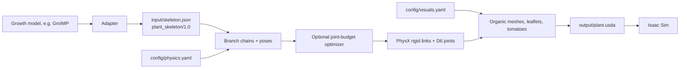

# AutoTom Digital Twin

[](#)
[](https://www.python.org/)
[](https://openusd.org/)
[](https://developer.nvidia.com/isaac-sim)
[](https://github.com/astral-sh/uv)

AutoTom Digital Twin turns a tomato plant skeleton into an articulated
OpenUSD plant for NVIDIA Isaac Sim: rigid links joined by bending joints,
organic stems, leaflets and tomatoes that can be pushed and dragged.

The input is a simple graph of segments (`plant_skeleton/1.0`), so any growth
model can feed it through a small adapter. The GroIMP dwarf-tomato model is
the reference source and its adapter is the example to copy.

## Quick start

```bash
git clone --recurse-submodules https://github.com/aledevv/autotom_digital_twin
cd autotom_digital_twin
./run_mainV2.sh                    # input/skeleton.json -> output/plant.usda -> Isaac Sim
./run_mainV2.sh --generate-only    # only write the USDA
./run_mainV2.sh --headless         # short physics check without the GUI
```

| File | Role |
| --- | --- |
| `input/skeleton.json` | The plant (GroIMP day 160 by default). Format: [`src/plant_skeleton/README.md`](src/plant_skeleton/README.md) |
| `input/examples/small_plant.json` | Smallest hand-written example |
| `config/physics.yaml` | Stiffness, damping, masses, joints, fruits, scale; every option commented |
| `config/visuals.yaml` | Mesh density, leaf generator, decorations, pose; every option commented |
| `output/plant.usda` | Generated scene plus `plant.manifest.json` (not tracked) |

To use another day of the GroIMP simulation:

```bash
uv run python -m exporterV2.adapters.groimp --day 80    # rewrites input/skeleton.json
```

To connect another growth model, write an adapter:
[`src/exporterV2/adapters/README.md`](src/exporterV2/adapters/README.md).

## Demo

Exporter V2 brought articulated branch dynamics, physical trusses, tomato
bodies with detachment joints, collision filtering, joint-budget optimization
and organic branch rendering. **V2.2 added a visual-realism pass**: organic
stems, 3D leaflet blades, gravity-shaped pedicels and shared PBR materials.
The static V1 exporter is preserved on the `thesis-archive` branch.

### Exporter V2.0 Demo
https://github.com/user-attachments/assets/357638f1-c9d2-485e-94ee-cd6e2d5e7535

## V2.2 — Realism Upgrade

V2.2 keeps the existing physical model and focuses on improving the visual
fidelity of the same GroIMP-derived plant. The main additions are:

- **Organic vegetative axes:** smooth radius transitions, local taper, root
  flare, junction bulges, terminal-fork shaping, and realtime segmented visual
  meshes built independently from the rigid collision proxies.
- **3D tomato leaflets:** compound-leaf blades use a cultivar-inspired width
  profile together with a longitudinal fold, gentle arch, and static gravity
  sag instead of a flat planar blade.
- **Procedural pedicel appearance:** the physical pedicel proxy can remain
  simple while a separate cubic gravity-curved visual tube provides a more
  natural fruit attachment, including deterministic small radius/side
  variations.
- **Shared organ materials:** realtime `UsdPreviewSurface` materials are reused
  for leaves, vegetative axes, and tomatoes; leaves and stems also expose an
  optional heavier `OmniSurface` look-development preset.
- **Ripening-aware tomato materials:** fruit color remains driven by maturation,
  while eight shared material buckets bound the number of authored shaders.
- **Visual/physics separation:** higher-fidelity appearance geometry is kept
  separate from the simple PhysX representation wherever practical, so the
  realism pass does not require a corresponding increase in collision
  complexity.

### V2.2 — Appearance and Geometry Demo
https://github.com/user-attachments/assets/93242538-9968-4b30-b65f-cb6679a7f718

### V2.2 — Gravity Response Demo
https://github.com/user-attachments/assets/e33f672d-72b8-41b2-9b4d-43bf5656226e


## V2.2 Gallery

<p align="center">
  
  
</p>
<p align="center">
  
  
</p>
<p align="center">
  
  
</p>
<p align="center">
  
  
</p>

## Pipeline



1. An adapter converts the growth model's output into a skeleton: one node per
   straight segment (stem, branch, petiole, leaf rachis, truss rachis, pedicel)
   plus leaflets and fruits.
2. The exporter groups nodes into branches and gives each node one rigid link
   with capsule colliders and a D6 joint whose drive comes from the segment's
   Young's modulus, radius and length.
3. Above about 220 joints the optimizer can lock or merge the least important
   ones.
4. Organic meshes, leaflet blades (procedural or from the `real_leaves`
   generator), curved pedicels and ripeness-coloured tomato spheres are added
   as visuals; physics never depends on them.
5. Overlapping colliders at rest are filtered pairwise, scene settings are
   written, and a manifest records counts, poses and masses.

The full description is in [`src/exporterV2/README.md`](src/exporterV2/README.md).

## Repository Layout

Thesis material (exporter V1, physics experiments, `model_randomized/`, demo
videos, historical notes and generated outputs) lives on the
[`thesis-archive`](https://github.com/aledevv/autotom_digital_twin/tree/thesis-archive)
branch. `main` keeps only the working pipeline.

```text
.
├── input/                          # skeleton.json (default input) and examples/
├── config/                         # physics.yaml, visuals.yaml (commented defaults)
├── output/                         # generated USDA + manifest (not tracked)
├── assets/gallery/                 # screenshots used in this README
├── data/plant_states/              # GroIMP plant_state/1.0 snapshots (GroIMP adapter input)
├── data/simulation_output/         # GroIMP CSV exports (legacy test fixtures)
├── external/real_leaves/           # leaf-shape generator submodule
├── model/                          # GroIMP model (RGG sources, inputs, params)
├── tests/                          # synthetic CSV scenarios for the legacy builder tests
├── extract_plant_states.sh         # extract plant states from a running GroIMP
├── run_mainV2.sh                   # build the plant and open it in Isaac Sim
└── src/
    ├── plant_skeleton/             # input format: model, JSON I/O, validation
    ├── exporterV2/                 # exporter, adapters, mesh generators, Isaac launcher
    ├── groimp_bridge/              # GroIMP API client and plant-state extraction
    └── plant_state/                # GroIMP plant_state/1.0 schema
```

## Features

| Category | Feature |
| --- | --- |
| Input | Generic `plant_skeleton/1.0` graph; GroIMP adapter as reference |
| Configuration | Commented YAML for physics and visuals; defaults ready to use |
| Geometry | Stem, side shoots, compound leaves, trusses, pedicels, tomatoes |
| Visuals | Organic segmented stems with taper, root flare and junction bulge |
| Visuals | 3D leaflets: procedural blade or scanned shapes from `real_leaves` |
| Visuals | Gravity-curved pedicels, decorative terminal forks (switchable) |
| Materials | Shared PBR materials; tomato colour from ripeness |
| Physics | Articulated rigid links with PhysX D6 drives |
| Fruits | None, visual (default) or physical with breakable joints (experimental) |
| Collision | Pairwise filter for colliders overlapping at rest |
| Optimization | Joint-budget lock/merge for large plants |
| Runtime | Isaac Sim launcher with interactive drag tools and headless check |

## Testing

No CI: run the suite by hand before merging.

```bash
uv run pytest -q \
  src/plant_skeleton/tests \
  src/exporterV2/tests \
  src/exporterV2/core/optimizations/tests \
  src/exporterV2/core/skinning/tests \
  src/exporterV2/legacy_csv/tests \
  src/groimp_bridge/tests \
  tests
```

`src/exporterV2/tests/test_exporter.py` locks the GroIMP day-160 plant to the
bodies, joints, poses, masses and drive gains of the previous exporter.
Interaction in the Isaac Sim GUI is checked by hand with `./run_mainV2.sh`.

## Documentation

- [`src/plant_skeleton/README.md`](src/plant_skeleton/README.md): input format with examples.
- [`src/exporterV2/README.md`](src/exporterV2/README.md): pipeline, folder map, what to edit.
- [`src/exporterV2/adapters/README.md`](src/exporterV2/adapters/README.md): writing an adapter.
- [`src/exporterV2/visuals/README.md`](src/exporterV2/visuals/README.md): where every mesh generator lives.
- `src/exporterV2/docs/`: physics, collisions, segmented visuals, leaf shapes, troubleshooting.
- `src/exporterV2/core/optimizations/docs/`: joint-budget optimizer.

## Notes for Reproducibility

- Generated outputs under `output/` are not tracked.
- Python bytecode, cache directories, and scratch USDA files are ignored.
- Manual demo scripts are intentionally outside normal pytest collection so
  paper/video assets do not interfere with automated validation.
- The deterministic terminal-fork and pedicel visual variations are keyed from
  branch identifiers, so repeated exports of the same topology keep the same
  visual orientation/variation.
- V2.2 material parameters are appearance parameters rather than measured plant
  optical constants; the material system is literature-informed but currently
  tuned empirically for Isaac Sim rendering.

### USD IDE Stubs

The `typings/` and `.vscode/` folders provide local USD type stubs for editor
completion in VSCode. Keep them when working on USD authoring code.
